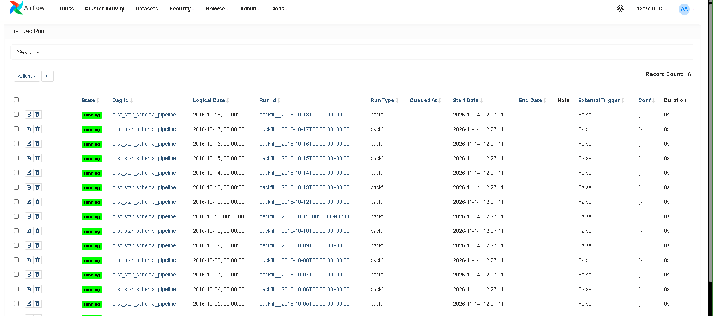
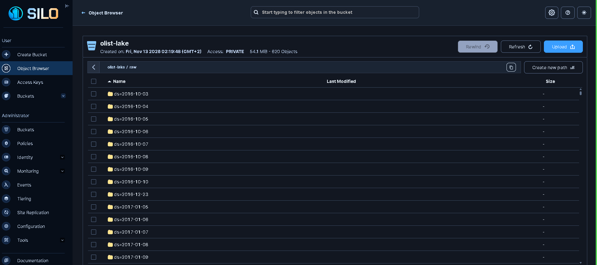
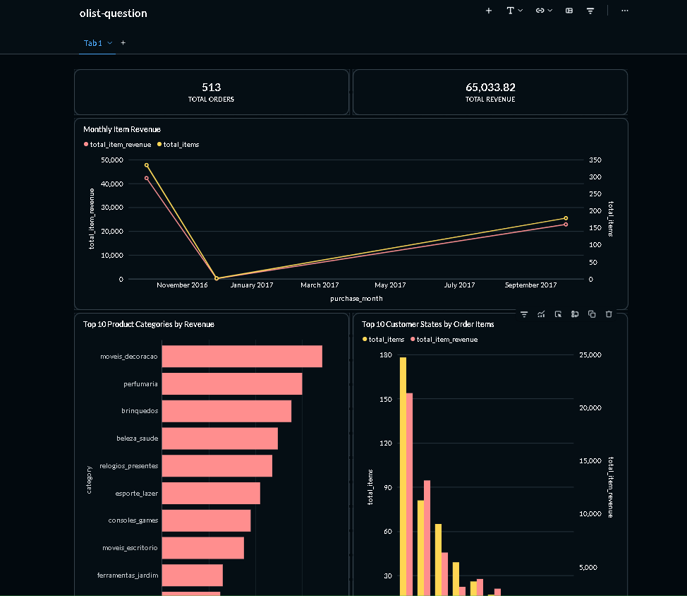

# Olist Star Schema ETL Pipeline

[](https://github.com/andybuild07/olist-ecommerce-etl/actions/workflows/ci.yml)


-C72E49?style=for-the-badge&logo=minio&logoColor=white)


End-to-end data engineering project built around the Olist e-commerce dataset using a containerized stack of **Apache Airflow**, **MinIO (Local S3)**, **PostgreSQL**, and **Metabase**, automated with a `Makefile`, and backed by automated testing and CI/CD via **GitHub Actions**.

## Quick Navigation

* [Architecture & Design Highlights](#architecture--design-highlights)
* [Pipeline & Dashboard Walkthrough](#pipeline--dashboard-walkthrough)
  * [Airflow UI](#airflow-ui)
  * [MinIO UI (Local S3)](#minio-ui-local-s3)
  * [Metabase UI](#metabase-ui)
* [Project Structure](#project-structure)
* [How to Run the Project](#how-to-run-the-project)
  * [1. Clone the Repository and Create `.env`](#1-clone-the-repository-and-create-env)
  * [2. Manage Services via `Makefile`](#2-manage-services-via-makefile)
  * [3. Upload Raw Data to MinIO (Manual Ingestion)](#3-upload-raw-data-to-minio-manual-ingestion)
  * [4. Unpause and Backfill the Pipeline via Terminal](#4-unpause-and-backfill-the-pipeline-via-terminal)
  * [5. Explore Analytics in Metabase](#5-explore-analytics-in-metabase)
  * [6. Run Tests](#6-run-tests)

## Architecture & Design Highlights

```text
Manual Raw Upload ──▶ MinIO (Local S3 / Landing Storage)
                         │
                         ▼
               Apache Airflow (`olist_star_schema_pipeline`, `@daily`, `catchup=False`)
                         │
                         ├──▶ Transform (`run_curated_transform`)
                         │
                         ▼
               PostgreSQL (Star Schema Warehouse)
                         │
                         ▼
               Metabase (Analytics & Dashboards)
```

* **Manual Landing + Automated Processing:** Raw Olist dataset files are uploaded manually to the MinIO (Local S3) landing bucket, after which Airflow orchestrates curated transformations and warehouse loads into PostgreSQL.
* **Logical-Date (`ds`) Driven:** Tasks receive `context['ds']` from Airflow so daily partitions and backfills are deterministic and isolated by logical date rather than relying on wall-clock functions (`now()`, `date.today()`, or `CURRENT_DATE`).
* **`catchup=False` + On-Demand Backfills:** Prevents flooding historical runs when unpausing the DAG while still supporting targeted historical backfills for specific dates via the CLI.
* **Idempotent Loads:** Designed so re-running a partition for a given `ds` (such as `DELETE`/`INSERT` by `ds` and `ON CONFLICT` upserts) safely updates data without duplicating records.
* **Two-Tier Testing Strategy:** Fast local `pytest` checks run without requiring a local database, while GitHub Actions spins up an ephemeral PostgreSQL service container to verify schema setup and idempotency in a clean environment.

## Pipeline & Dashboard Walkthrough

### Airflow UI



### MinIO UI (Local S3)



### Metabase UI



## Project Structure

```text
olist-ecommerce-etl/
├── .github/
│   └── workflows/
│       └── ci.yml                  # GitHub Actions CI with ephemeral Postgres service
├── dags/                           # Airflow DAG definitions
├── docs/
│   └── screenshots/                # Pipeline & dashboard screenshots for README
│       ├── airflow-ui.png
│       ├── minio-ui.png
│       └── metabase-ui.png
├── src/                            # Transformation and star-schema load modules
├── tests/
│   ├── test_dags.py                # Fast DAG syntax and structure checks
│   └── test_idempotency_sql.py     # Database idempotency tests (uses TEST_DATABASE_URL)
├── .env.example                    # Template environment configuration
├── .gitignore                      # Ignores caches, virtualenvs, logs, and local env files
├── docker-compose.yml              # Service definitions (Airflow, Postgres, MinIO, Metabase)
├── Makefile                        # Automation targets (`up`, `down`, `nuke`, `logs`)
├── pytest.ini                      # Pytest configuration (e.g., ignoring logs/)
└── README.md
```

## How to Run the Project

### 1. Clone the Repository and Create `.env`

Clone the repo and create your `.env` file from `.env.example`:

```bash
git clone https://github.com/andybuild07/olist-ecommerce-etl.git
cd olist-ecommerce-etl
```

```powershell
# PowerShell
Copy-Item .env.example .env
```

```bash
# Bash / macOS / Linux
cp .env.example .env
```

Review `.env` and adjust any ports, credentials, or bucket/database settings if needed to match `docker-compose.yml` and `Makefile`.

### 2. Manage Services via `Makefile`

Start all containers in detached mode:

```bash
make up
```

Follow Airflow logs live:

```bash
make logs
```

Stop and remove containers while keeping volumes:

```bash
make down
```

Stop containers and remove volumes (`nuke` for a full volume reset):

```bash
make nuke
```

### 3. Upload Raw Data to MinIO (Manual Ingestion)

Raw ingestion into MinIO (Local S3) is performed manually before running or backfilling the pipeline:

1. Open the **MinIO Console** on the port configured in your `.env` / `docker-compose.yml`.
2. Ensure the landing bucket exists and upload the raw Olist CSV files into the expected landing path.
3. Verify the files are visible in MinIO before triggering Airflow runs.

### 4. Unpause and Backfill the Pipeline via Terminal

Because backfilling in the Airflow UI is not used for this Airflow version, run historical backfills directly from the terminal using the Airflow CLI:

1. Open the **Airflow UI** on the port configured in your `.env` / `docker-compose.yml` and unpause `olist_star_schema_pipeline`.
2. Run a backfill from the terminal for your target start and end dates (adjust the service name if your compose service is named `airflow-webserver` or similar):

```bash
docker compose exec airflow-scheduler airflow dags backfill \
  -s 2017-10-02 \
  -e 2017-10-05 \
  olist_star_schema_pipeline
```

Because tasks rely on `context['ds']` and are built for idempotency, re-running a date range cleanly refreshes those partitions.

### 5. Explore Analytics in Metabase

Open **Metabase** on its configured port, connect or refresh your PostgreSQL warehouse data source if needed, and view the star schema tables and dashboard cards.

### 6. Run Tests

Run local tests without needing a local database setup:

```powershell
# PowerShell
Remove-Item Env:TEST_DATABASE_URL -ErrorAction SilentlyContinue
pytest tests
```

```bash
# Bash / macOS / Linux
unset TEST_DATABASE_URL
pytest tests
```

In **GitHub Actions**, `.github/workflows/ci.yml` automatically starts a temporary PostgreSQL service container, initializes the schema, sets `TEST_DATABASE_URL`, and runs `pytest tests` across your test suite on pushes and pull requests.